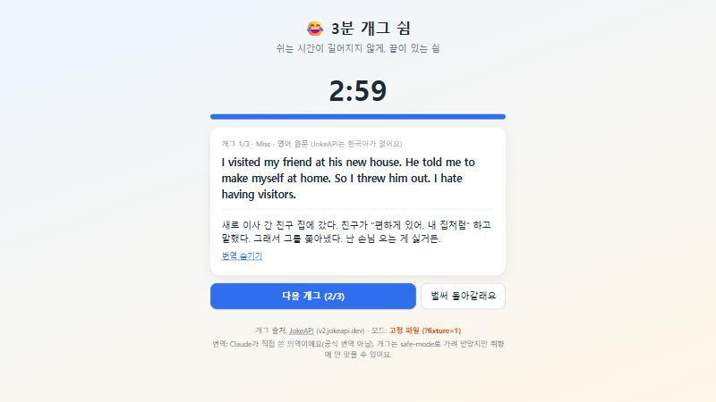

# 3분 개그 쉼

일하다 잠깐 쉴 때, **3분 동안 짧은 농담 하나씩** 보여 주는 쉼터 웹페이지입니다. 빌드 없이 `index.html`만 열면 동작합니다.



| 복귀 화면 | 폰 크기 |
|---|---|
|  |  |

## 무엇을 해 주나

- [JokeAPI](https://v2.jokeapi.dev/)에서 농담을 받아 한국어 번역본과 함께 보여 줍니다.
- 3분 타이머가 도는 동안 쉬고, 끝나면 "복귀" 화면으로 돌아옵니다.
- API가 실패해도 `fixtures/`의 저장된 농담으로 동작합니다.

## 구성

```
rules.js    농담 고르기·타이머 규칙(순수 함수)
api.js      JokeAPI 호출
render.js   화면 그리기
app.js      연결
fixtures/   테스트·오프라인용 저장 데이터
```

기획과 겪은 문제는 [기획_한장.md](기획_한장.md), [문제기록.md](문제기록.md)에 있습니다.

## 실행

```bash
python -m http.server 8000
```

브라우저에서 http://localhost:8000 을 엽니다.
